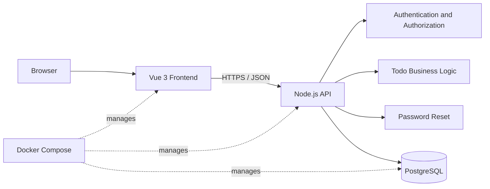
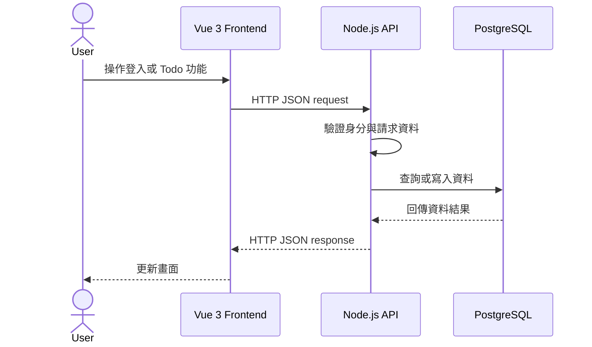

# 系統架構

## 概觀

Todo Full Stack 採前後端分離架構：Vue 3 前端透過 REST API 與 Node.js 後端溝通，後端使用 PostgreSQL 保存資料；Docker Compose 統一管理三個服務的執行環境。



## 元件職責

| 元件 | 職責 |
| --- | --- |
| Vue 3 | 提供註冊、登入、忘記密碼與 Todo 管理介面；以元件與狀態管理維護畫面狀態並呼叫 API。 |
| Node.js | 提供 REST API、驗證輸入、處理認證與授權、執行商業邏輯。 |
| PostgreSQL | 保存使用者、Todo 與密碼重設 Token。資料模型見 [database.md](database.md)。 |
| Docker | 以容器執行前端、後端與資料庫，並透過 Compose 管理服務關係。 |

API 介面定義見 [api.md](api.md)。

## 運作流程

使用者在 Vue 3 操作介面後，前端向 API 發出 JSON 請求。Node.js 會驗證使用者身分與輸入資料，執行業務規則後讀寫 PostgreSQL，最後將結果回傳前端更新畫面。



## 後端分層

後端採用下列責任分離，避免路由處理直接耦合資料庫實作：

```text
routes -> controllers -> services -> repositories -> PostgreSQL
```

- `routes`：定義 HTTP 方法、路徑與認證 Middleware。
- `controllers`：解析請求並將結果轉換為 HTTP 回應。
- `services`：處理登入、密碼重設與 Todo 存取規則。
- `repositories`：集中資料庫查詢與交易。

## 認證與安全

- 密碼僅保存安全雜湊值，且不寫入日誌或 API 回應。
- 受保護的 Todo 操作必須從已驗證身分取得 `user_id`，不可相信用戶端傳入的使用者 ID。
- 認證 Cookie 應設為 `HttpOnly`、`Secure`（正式環境）與適當的 `SameSite`；若跨站請求，需設置 CSRF 防護。
- 忘記密碼流程保存 Token 雜湊、設定到期時間，且回應不透露 email 是否已註冊。
- API 應驗證輸入，並在登入與密碼重設端點施加速率限制。

## Docker 服務

建議以 `docker compose` 管理以下服務：

| 服務 | 預設用途 | 對外連接埠 |
| --- | --- | --- |
| `frontend` | 建置並提供 Vue 3 應用程式 | `3000` |
| `api` | 執行 Node.js API | `3001` |
| `db` | PostgreSQL 資料庫與持久化 Volume | `5432` |

服務間透過 Compose 網路以服務名稱連線，例如 API 使用 `db:5432` 連接資料庫。前端公開的 API 位址與後端資料庫連線字串均應由環境變數設定，並在 `.env.example` 提供變數名稱與範例值，不提交真實機密。

## 開發流程

1. **文件與架構規劃**：完成 API、資料庫與系統架構文件，確認功能範圍與介面契約。
2. **建立專案及 Docker 環境**：初始化 Vue 3、Node.js 專案，建立 Docker Compose 與 PostgreSQL 服務。
3. **API 開發**：實作認證、密碼重設與 Todo CRUD API，並完成資料庫 migration。
4. **前端畫面**：完成註冊、登入、忘記密碼與 Todo 管理介面。
5. **前後端串接**：由 Vue 3 呼叫 API，處理登入狀態、資料讀寫與錯誤回應。
6. **測試**：執行 API、元件與前後端整合測試，覆蓋主要使用流程。
7. **Demo**：在 Docker Compose 環境完成驗證並展示完整流程。
