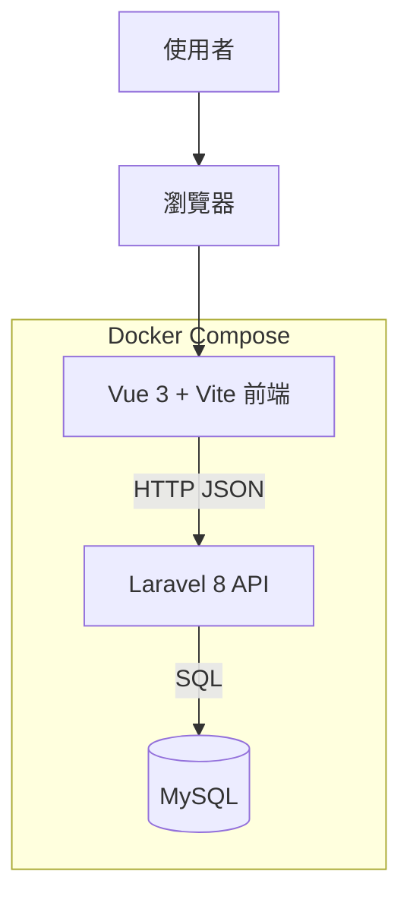
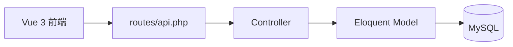
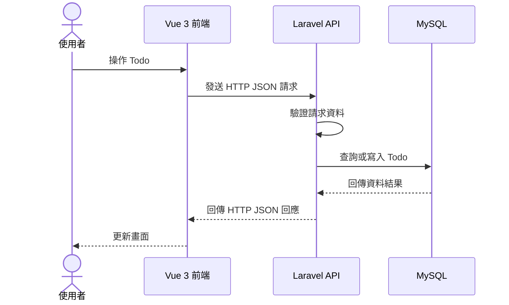

# 系統架構

## MVP 概觀

Todo Full Stack 採用前後端分離架構。使用者透過瀏覽器操作 Vue 3 前端，前端以 HTTP JSON 呼叫 Laravel REST API，API 再透過 MySQL 儲存 Todo 資料。本機開發時三個服務由 Docker Compose 管理；正式環境部署到 Hostinger 共享主機，見 [deployment-roadmap.md](deployment-roadmap.md)。

## 元件職責

| 元件 | 職責 |
| --- | --- |
| Vue 3 + Vite | 顯示 Todo 清單，提供新增、編輯、完成狀態切換與刪除操作。 |
| Laravel 8（PHP） | 提供 REST API、驗證請求資料，並處理認證與 Todo CRUD 流程。 |
| MySQL | 保存使用者與 Todo 資料，確保資料在服務重啟後仍可保留。 |
| Docker Compose | 本機開發時統一管理前端、API 與資料庫服務，以及服務間的連線設定。 |

## API 內部流程

後端由 Route 接收 HTTP 請求，交由 Controller 處理，再透過 Eloquent Model 存取 MySQL。目前以簡化結構實作，功能穩定後再視需要拆出 Service 等層級。

## Todo 操作流程

## Docker 服務

| 服務 | 用途 | 對外連接埠 |
| --- | --- | --- |
| `frontend` | 執行 Vue 3 開發伺服器 | `3010` |
| `api` | 執行 Laravel REST API（`php -S`） | `3011` |
| `db` | 執行 MySQL 8 與保存資料 | `3306`（可用根目錄 `.env` 的 `MYSQL_PORT` 調整） |

API 在 Docker Compose 內透過 `db:3306` 連接 MySQL；瀏覽器則透過 `localhost:3011` 呼叫 API。對外連接埠只影響從電腦連進資料庫（例如 DBeaver），不影響 API 連線。

## 第一階段範圍

- 註冊、登入、登出，以及使用者權限（Todo 僅能存取自己的資料，`todos` 需關聯 `users.id`）。
- Todo CRUD：建立、讀取、更新完成狀態、編輯與刪除。
- MySQL 資料表（由 Laravel migration 建立）。
- Vue 3 前端與 REST API 串接。
- Docker Compose 啟動與本機開發環境。

## 後續規劃

忘記密碼先不納入 MVP，待上述功能完成後再加入。完整 API 規劃見 [api.md](api.md)，資料模型見 [database.md](database.md)。
