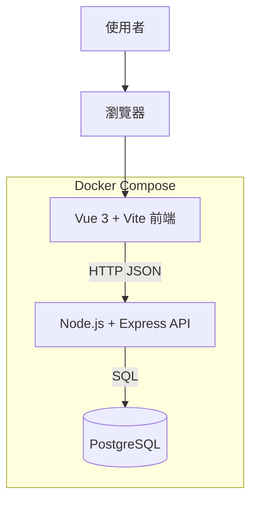
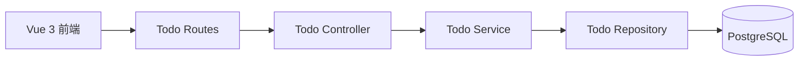
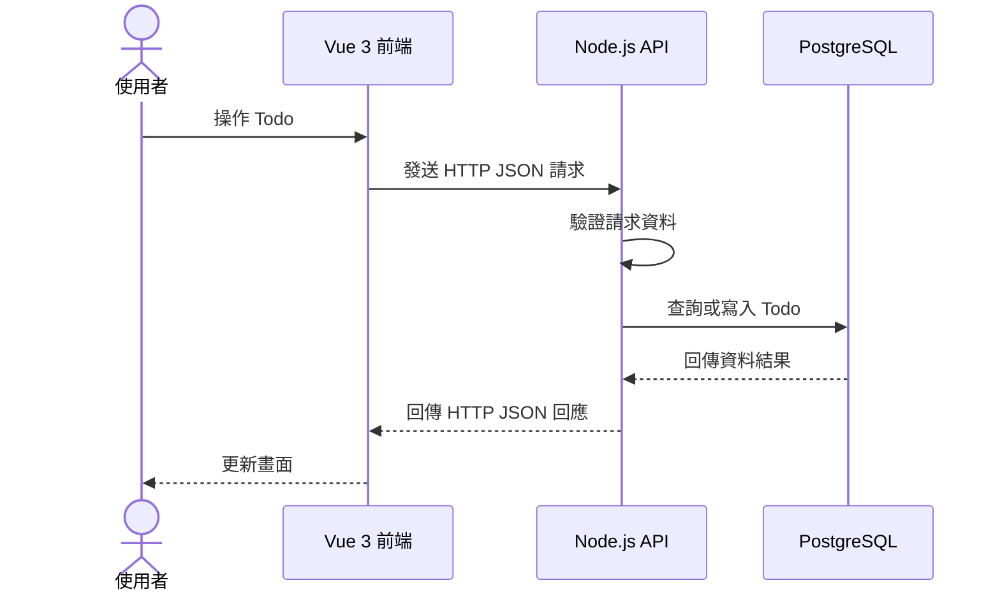

# 系統架構

## MVP 概觀

Todo Full Stack 採用前後端分離架構。使用者透過瀏覽器操作 Vue 3 前端，前端以 HTTP JSON 呼叫 Node.js REST API，API 再透過 PostgreSQL 儲存 Todo 資料。三個服務由 Docker Compose 管理。

## 元件職責

| 元件 | 職責 |
| --- | --- |
| Vue 3 + Vite | 顯示 Todo 清單，提供新增、編輯、完成狀態切換與刪除操作。 |
| Node.js + Express | 提供 REST API、驗證請求資料，並處理 Todo CRUD 流程。 |
| PostgreSQL | 保存 Todo 資料，確保資料在服務重啟後仍可保留。 |
| Docker Compose | 統一管理前端、API 與資料庫服務，以及服務間的連線設定。 |

## API 內部流程

後端先由 Route 接收 HTTP 請求，再交由 Controller 與 Service 處理，最後透過 Repository 存取 PostgreSQL。第一階段可先以簡化結構實作，功能穩定後再逐步拆分責任。

## Todo 操作流程

## Docker 服務

| 服務 | 用途 | 對外連接埠 |
| --- | --- | --- |
| `frontend` | 執行 Vue 3 開發伺服器 | `3010` |
| `api` | 執行 Node.js REST API | `3011` |
| `db` | 執行 PostgreSQL 與保存資料 | `5432` |

API 在 Docker Compose 內透過 `db:5432` 連接 PostgreSQL；瀏覽器則透過 `localhost:3011` 呼叫 API。

## 第一階段範圍

- Todo CRUD：建立、讀取、更新完成狀態、編輯與刪除。
- PostgreSQL 資料表與基本資料初始化。
- Vue 3 前端與 REST API 串接。
- Docker Compose 啟動與本機開發環境。

## 後續規劃

登入、註冊、登出、忘記密碼與使用者權限先不納入 MVP，待 Todo 主流程完成後再加入。完整 API 規劃見 [api.md](api.md)，資料模型見 [database.md](database.md)。
